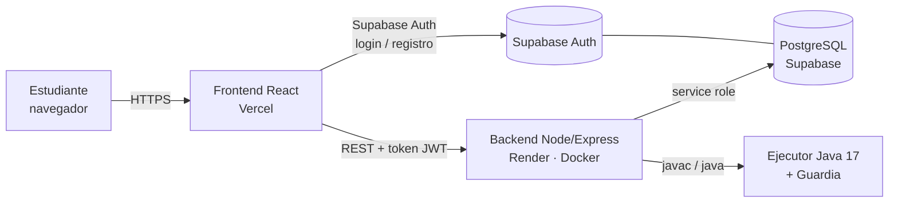
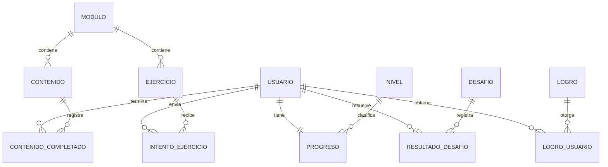

# DUALDEV · Guía para la documentación del proyecto

Este archivo reúne **todo lo que el equipo necesita para redactar el documento del proyecto**: qué es DUALDEV, cómo está construido, qué requisitos cumple, cómo se probó y qué decisiones se tomaron. Está escrito para que cada sección se pueda copiar, adaptar o ampliar en el documento final.

> Todo lo que aparece aquí sale del código y de las pruebas reales del repositorio (actualizado al 2026-10-28). Si algo cambia, la fuente de verdad es el código; el detalle día a día está en `PROGRESO.md`.

---

## 0. Cómo usar esta guía (para el equipo)

Estructura sugerida del documento final y de dónde sacar cada parte:

| Capítulo del documento | Sección de esta guía |
|---|---|
| 1. Introducción y planteamiento del problema | §1 |
| 2. Objetivos (general y específicos) | §1 |
| 3. Alcance y población | §1, §2 |
| 4. Requisitos funcionales y no funcionales | §3 |
| 5. Arquitectura y tecnologías | §4, §5 |
| 6. Modelo de datos | §6 |
| 7. Diseño de la API | §7 |
| 8. Contenido educativo | §8 |
| 9. Gamificación | §9 |
| 10. Ejecución de código y seguridad | §10, §11 |
| 11. Interfaz de usuario | §12 |
| 12. Pruebas y resultados | §13 |
| 13. Despliegue | §14 |
| 14. Conclusiones, limitaciones y trabajo futuro | §16, §17 |
| Anexos: manual de instalación, glosario, capturas | §15, §18, §19 |

Sugerencia de reparto: una persona por bloque (1–4, 5–7, 8–11, 12–14) y una persona que unifique el estilo al final.

---

## 1. Descripción general

**Nombre:** DUALDEV — *Aprende · Practica · Avanza*

**Qué es:** una plataforma web educativa para aprender los **ciclos en Java** (`for`, `while`, `do-while`, `break`/`continue` y ciclos anidados), con **gamificación** (puntos XP, niveles, logros, retos y ranking). Todo el contenido y la interfaz están en español.

**Población objetivo:** estudiantes del **Instituto Técnico Industrial (semillero de programación)** que empiezan a programar.

**Problema que atiende:** los ciclos son uno de los primeros temas donde los estudiantes se bloquean (vueltas de más o de menos, ciclos infinitos, acumuladores mal ubicados). Los ejercicios tradicionales solo dicen "correcto/incorrecto" y no explican **por qué** falló el programa.

**Objetivo general (propuesta):** desarrollar una plataforma web que permita a los estudiantes aprender y practicar ciclos en Java con retroalimentación inmediata y explicativa, ejecutando código Java real y motivando la práctica mediante gamificación.

**Objetivos específicos (propuesta):**
1. Organizar el contenido en módulos progresivos con lecciones y ejercicios de dificultad creciente.
2. Ejecutar y evaluar código Java real de forma segura, con casos de prueba ocultos.
3. Dar retroalimentación "tono profe" que explique el error y cómo corregirlo.
4. Motivar la práctica con puntos, niveles, logros, retos y ranking.
5. Mostrar al estudiante su progreso y una retroalimentación al terminar cada sección.

---

## 2. Alcance

**Incluye:**
- Registro, inicio y cierre de sesión con cuenta propia.
- 5 módulos con 16 lecciones, 56 ejercicios y 12 retos.
- Editor de código Java con resaltado de sintaxis y atajos tipo IDE.
- Ejecución real de Java (JDK 17) con casos de prueba visibles y ocultos.
- Retroalimentación detallada por tipo de error.
- Gamificación completa y ranking del semillero.
- Resumen y retroalimentación por módulo, y revisión de las respuestas correctas ya enviadas.

**No incluye (decisiones de alcance):**
- Ejecutar programas Java arbitrarios fuera de los ejercicios (solo código de ejercicios, con límites).
- Panel para el docente (el contenido se administra en la base de datos con `supabase/seed.sql`).
- Aplicación móvil nativa (la web es responsive y funciona en celular).
- Recuperación de contraseña (el botón está visible pero deshabilitado).

---

## 3. Requisitos y trazabilidad

### 3.1 Requisitos funcionales

| Código | Requisito | Cómo se cumple | Verificado |
|---|---|---|---|
| RF-01 | Registro de estudiantes | Supabase Auth; un trigger crea el perfil y el progreso en PostgreSQL; correo duplicado rechazado | ✅ e2e |
| RF-02 | Inicio de sesión | Supabase Auth; el backend valida el token JWT en cada petición | ✅ e2e |
| RF-03 | Cierre de sesión | Al cerrar, el backend rechaza el token anterior | ✅ e2e |
| RF-04 | Módulos con progreso y bloqueo | Un módulo se desbloquea con ≥ 50 % del anterior; un módulo bloqueado responde 403 | ✅ e2e |
| RF-05 | Lecciones | Explicación con formato, código de ejemplo, salida y tip | ✅ e2e |
| RF-06 | Ejercicios (4 tipos) y código Java real | Selección, respuesta corta, predecir salida y código; la solución nunca se expone antes de resolver | ✅ e2e |
| RF-07 | Retroalimentación | Explica el error (compilación con línea, salida distinta, ciclo infinito, etc.) y da pistas progresivas | ✅ e2e |
| RF-08 | Registro de progreso | Se guardan intentos, lecciones completadas y duración | ✅ e2e |
| RF-09 | Perfil, dashboard y ranking | Nivel, puntos, racha, logros y estadísticas; el ranking no expone ids ni correos de otros | ✅ e2e |
| RF-10 | Puntos | Solo el backend asigna puntos; cada ejercicio, lección o reto da puntos **una sola vez** | ✅ e2e |
| RF-11 | Logros | Se desbloquean automáticamente según criterios (ejercicios, puntos, módulos, racha…) | ✅ e2e |
| RF-12 | Retos | Diario (rota cada día), semanal (cada lunes) y mini-retos; un reto no vigente no se puede enviar | ✅ e2e |

### 3.2 Requisitos no funcionales

| Código | Requisito | Resultado |
|---|---|---|
| RNF-01 | Usabilidad: cualquier sección a ≤ 3 clics desde el menú | ✅ |
| RNF-02 | Rendimiento: cargas < 3 s, retroalimentación idealmente < 2 s | ✅ en local: cargas 0,3–0,65 s; envío de código ≤ 1,8 s |
| RNF-03 | Integridad con concurrencia: sin puntos duplicados | ✅ 5 envíos simultáneos pagan una sola vez |
| Seguridad | RLS, ejecución aislada, límites de uso, sin secretos en el frontend | ✅ ver §11 |

### 3.3 Funciones agregadas por retroalimentación de la docente (2026-10-27/28)
- Progreso visible y **resumen con retroalimentación al terminar cada sección (módulo)**.
- Introducción a los ciclos reescrita + lección de **prueba de escritorio**.
- **23 ejercicios nuevos** de mayor complejidad (de 33 a 56).
- Consola mejorada y colores revisados.
- **Editor tipo IDE**: escribir `for` y presionar Tab arma la estructura.
- Ver la **respuesta correcta que el estudiante ya dio**.
- Sin "auto-verificación" en el módulo 1.

---

## 4. Arquitectura

Arquitectura cliente-servidor en tres capas: **frontend (SPA)** → **API REST** → **base de datos/autenticación**.



**Backend por capas:** `routes → controllers → services → repositories`, con `middleware` para autenticación, validación, límites de uso y errores.

**Regla clave de diseño:** toda la lógica de gamificación (puntos, niveles, logros) se decide **solo en el backend**; el frontend nunca envía puntos.

---

## 5. Tecnologías

| Capa | Tecnología | Por qué |
|---|---|---|
| Frontend | React 19 + Vite + TypeScript | SPA rápida, tipado estático, ecosistema maduro |
| Estilos | Tailwind CSS v4 | Diseño consistente con tokens de color (paleta 100 % verde) |
| Backend | Node.js + Express 5 (ESM) | API REST simple; mismo lenguaje que el frontend |
| Validación | Zod | Validación de entradas y variables de entorno |
| Base de datos | PostgreSQL (Supabase) | Relacional, con RLS y funciones transaccionales |
| Autenticación | Supabase Auth | Contraseñas gestionadas por el proveedor (nunca en tablas propias) |
| Ejecución de código | JDK 17 (Temurin) | Java real; JDK 17 porque la "Guardia" usa el Security Manager (eliminado desde Java 24) |
| Contenedor | Docker | Imagen con Node + JDK para el backend |
| Hosting | Vercel (frontend), Render (backend), Supabase (BD) | Planes gratuitos, sin tarjeta |

Identidad visual: tipografías Sora (títulos), Plus Jakarta Sans (texto) y JetBrains Mono (código); paleta esmeralda (`#03110c` fondo, `#1ed48a` primario, `#b6ff3c` acento de progreso).

---

## 6. Modelo de datos

### 6.1 Tablas

| Tabla | Para qué sirve |
|---|---|
| `nivel` | Escala de 7 niveles por puntos |
| `modulo` | Módulos del curso (orden, dificultad, disponible) |
| `contenido` | Lecciones (explicación, código y salida de ejemplo, tip, minutos, puntos) |
| `ejercicio` | Ejercicios (tipo, dificultad, puntos, opciones, solución, pistas, casos de prueba, estructuras requeridas, errores comunes) |
| `desafio` | Retos (diario, semanal, mini) |
| `logro` | Catálogo de logros y su criterio |
| `usuario` | Perfil del estudiante (ligado a `auth.users`) |
| `progreso` | Puntos acumulados por estudiante |
| `intento_ejercicio` | Cada envío: respuesta, si fue correcta, puntos, retroalimentación, duración |
| `contenido_completado` | Lecciones terminadas por estudiante |
| `resultado_desafio` | Resultado de cada reto por estudiante |
| `logro_usuario` | Logros obtenidos y fecha |

### 6.2 Diagrama entidad-relación (simplificado)



### 6.3 Funciones en la base de datos (transaccionales)
- `registrar_intento_ejercicio`, `completar_contenido`, `registrar_resultado_desafio`: guardan el intento y otorgan puntos **una sola vez** (índices únicos + `security definer`).
- `sumar_puntos`, `nivel_para_puntos`: actualizan puntos y nivel.
- `handle_new_user`: trigger que crea `usuario` y `progreso` al registrarse.

### 6.4 Seguridad de datos
- **RLS (Row Level Security)** en todas las tablas de usuario: cada estudiante solo lee lo suyo.
- Las tablas `ejercicio` y `desafio` no son legibles por el estudiante (contienen soluciones y casos ocultos): solo el backend las lee.
- Migraciones versionadas en `supabase/migrations/` (7 archivos); catálogo en `supabase/seed.sql` (idempotente).

---

## 7. API REST

Base: `/api`. Todas las rutas (salvo `/health`) requieren `Authorization: Bearer <token>`.

| Método | Ruta | Descripción |
|---|---|---|
| GET | `/health` | Estado del servicio y de la BD |
| GET | `/me` | Datos del estudiante y su nivel |
| GET | `/dashboard` | Resumen: puntos, nivel, racha, módulos, logros, actividad |
| GET | `/modules` | Módulos con progreso y bloqueo |
| GET | `/modules/:id` | Detalle del módulo: lecciones y estado de cada ejercicio |
| GET | `/lessons/:id` | Lección completa |
| POST | `/lessons/:id/complete` | Marca la lección (puntos una sola vez) |
| GET | `/exercises/:id` | Ejercicio sin solución; si ya está resuelto incluye `mi_respuesta` |
| POST | `/exercises/:id/submit` | Evalúa la respuesta y devuelve retroalimentación (límite: 30/min) |
| POST | `/code/run` | Ejecuta el código con la entrada de ejemplo, sin puntos (límite: 20/min) |
| GET | `/challenges` | Retos vigentes |
| GET | `/challenges/:id` | Detalle del reto |
| POST | `/challenges/:id/run` | Ejecuta código del reto |
| POST | `/challenges/:id/submit` | Envía la respuesta del reto |
| GET | `/ranking` | Ranking (otros estudiantes como "Nombre I.") |
| GET | `/profile` | Perfil con estadísticas |
| PATCH | `/profile` | Actualiza nombre y grado |

---

## 8. Contenido educativo

| Módulo | Dificultad | Lecciones | Ejercicios | Temas |
|---|---|---|---|---|
| 1. Introducción a ciclos | Básico | 5 | 9 | Qué es un ciclo, partes, Scanner, los 3 ciclos, prueba de escritorio |
| 2. Ciclo for | Básico | 4 | 14 | Estructura, contar hacia atrás/saltos, acumuladores, operador % |
| 3. Ciclo while | Intermedio | 3 | 11 | Estructura, ciclos infinitos, while vs for |
| 4. Ciclo do-while | Intermedio | 2 | 9 | Estructura, menús, validaciones, centinelas |
| 5. Ciclos combinados | Avanzado | 2 | 13 | break/continue, ciclos anidados |
| **Total** | | **16** | **56** | + 12 retos |

**Tipos de ejercicio:** selección múltiple, respuesta corta, predecir la salida y **código Java real** evaluado con casos de prueba (visibles y ocultos).

**Ejemplos de ejercicios avanzados:** factorial con `long`, divisores, mayor y menor con negativos, invertir un número, secuencia de Collatz, número palíndromo, adivina el número, cajero con menú (`do-while`), números primos, pirámide de números y tablero de ajedrez.

**Calidad del contenido:** las 56 soluciones se verificaron ejecutándolas con el ejecutor Java real contra todos sus casos de prueba.

---

## 9. Gamificación

**Puntos:** lección 50 XP; ejercicio fácil 30–40, medio 60, difícil 100. Cada uno se paga **una sola vez**.

**Niveles:**

| Nivel | Nombre | Puntos mínimos |
|---|---|---|
| 1 | Inicial | 0 |
| 2 | Aprendiz | 300 |
| 3 | Explorador | 800 |
| 4 | Programador Junior | 1100 |
| 5 | Programador Intermedio | 1500 |
| 6 | Programador Avanzado | 2100 |
| 7 | Maestro de ciclos | 2700 |

**Logros (12):** Primer ciclo, 10 ejercicios, Módulo superado, Maestro de ciclos, Cien puntos, En marcha (300 XP), Retador, Racha 7 días, Racha 30 días, Perfección (5 al primer intento), Nivel 5 y Top 3.

**Otras reglas:**
- Racha: días consecutivos con actividad (sigue viva si hubo actividad hoy o ayer, hora de Bogotá).
- Meta semanal: 5 ejercicios (la semana empieza el lunes).
- Desbloqueo: un módulo se abre con ≥ 50 % del anterior.
- Ranking: general, semanal y por módulo; los demás estudiantes aparecen como "Nombre I." (privacidad de menores).

---

## 10. Ejecución de código y retroalimentación

**Dos acciones en la práctica:**
1. **▶ Ejecutar código:** compila y corre con la entrada de ejemplo, sin puntos ni intento registrado.
2. **Enviar respuesta:** evalúa contra **todos** los casos de prueba (incluidos los ocultos) y registra el intento.

**Retroalimentación "tono profe"** (cada error dice qué pasó y por qué):
- **Selección:** cada opción incorrecta tiene su explicación.
- **Predecir salida:** detecta vuelta de más o de menos, orden inverso, `print` en vez de `println`, espacios.
- **Código:** `;` después de `for`/`while`, acumulador declarado dentro del ciclo, ciclo infinito (qué variable no cambia y en qué línea), `for` que cuenta al revés, valor fijo copiado del ejemplo, comas en el `for`, `=` en vez de `==`, variable usada fuera de su ciclo, Scanner sin `import`.
- **Errores de compilación** traducidos al español con número de línea.
- **Pistas progresivas** tras cada fallo y solución visible después de 3 fallos.
- **Nunca se revelan los datos de un caso oculto.**

---

## 11. Seguridad

- **Autenticación** con Supabase Auth; el backend valida el JWT en cada petición. Sin autenticación falsa en el navegador.
- **La llave `service_role` solo existe en el backend**, nunca en el frontend. Ningún secreto se versiona en el repositorio (que es público).
- **RLS** en todas las tablas de usuario; las soluciones y los casos de prueba no son accesibles desde el cliente.
- **Límites de uso:** 20 ejecuciones y 30 envíos por minuto por estudiante (responde 429 si se excede).
- **Validación de entradas** con Zod; JSON malformado responde 400 (no 500).
- **Ejecutor de Java aislado** del proceso de la API:
  - **"Guardia"** (Security Manager propio): bloquea archivos, red, procesos, lectura de variables de entorno y limita la cantidad de hilos (evita la "bomba de hilos").
  - Límites de tiempo de compilación y ejecución, de tamaño de código (20 KB) y de salida.
  - Corre dentro de un contenedor Docker sin privilegios de root.
  - Se diseñó además un usuario Linux `sandbox` separado. Render no permite cambiar de usuario dentro del contenedor, así que ahí la Guardia es la barrera principal (decisión explícita y documentada en el `Dockerfile`).

---

## 12. Interfaz de usuario

Pantallas: **Login/Registro**, **Dashboard**, **Módulos**, **Resumen del módulo**, **Lección**, **Práctica**, **Retos**, **Ranking** y **Perfil**, dentro de un `AppShell` (menú lateral en escritorio, barra superior en celular).

Funciones destacadas:
- **Editor tipo IDE:** resaltado de Java, números de línea, línea actual, marcado de líneas con error. Atajos: `for`, `while`, `do`, `if`, `sout`, `scan`, `leer`, `main` + **Tab** arman la estructura; Tab salta entre campos; Enter mantiene la sangría y cierra llaves; barra "Insertar" con botones (útil en celular).
- **Consola tipo terminal:** estado (compilando / sin errores / error de compilación / tiempo agotado), entrada usada, salida numerada, copiar y limpiar.
- **Resumen del módulo:** anillo de avance, insignia, estadísticas, retroalimentación por habilidad (conceptos, leer código, escribir programas), lista de ejercicios con su estado, autoevaluación del estudiante y siguiente paso recomendado.
- **"Tu respuesta correcta":** al volver a un ejercicio resuelto se muestra la respuesta que el estudiante envió.
- **Lecciones con formato:** pasos numerados, viñetas y tablas de prueba de escritorio.
- Accesibilidad: navegación con teclado, foco visible, etiquetas ARIA, respeta `prefers-reduced-motion`; diseño responsive sin scroll horizontal.

---

## 13. Pruebas y resultados

| Prueba | Qué verifica | Resultado |
|---|---|---|
| Unitarias (`npm test` en backend) | Utilidades, ejecutor Java real, análisis de errores, configuración, limitador, caché | 100 pruebas: 98 pasan, 2 específicas de Linux se omiten en Windows |
| Punta a punta (`npm run test:e2e`) | RF-01 a RF-12, seguridad, concurrencia y tiempos contra la BD real | **37/37** |
| Recorrido completo del curso | Las 16 lecciones y los **56 ejercicios** por la API real: respuesta incorrecta con retroalimentación, ejecución, acierto, sin puntos dobles, respuesta guardada | **56/56**, 0 problemas, 5 módulos al 100 % |
| Validación del contenido | Cada solución ejecutada con Java contra sus casos; seed aplicado 2 veces en PostgreSQL local | Sin errores |
| Revisión visual | Todas las pantallas en escritorio y celular (390 px), consola del navegador | 0 errores de la aplicación |
| Lint y build | `oxlint` y `tsc -b && vite build` | Limpios |

Tiempos medidos (local): cargas de pantalla 0,3–0,65 s; envío de ejercicio hasta 1,8 s.

---

## 14. Despliegue

| Componente | Servicio | Notas |
|---|---|---|
| Frontend | Vercel | Despliegue automático al hacer push a `main` |
| Backend | Render (Docker) | Imagen con Node 24 + JDK 17; despliegue automático |
| Base de datos y Auth | Supabase (plan gratuito) | Migraciones y seed aplicados |
| Mantener activos | cron-job.org | Evita que Render y Supabase se "duerman" |

Costo: **$0** (todos en plan gratuito, sin tarjeta). Guía paso a paso en `DESPLIEGUE.md`.

---

## 15. Manual de instalación local (anexo)

Requisitos: Node.js 24, JDK 17 y un proyecto de Supabase.

```bash
# 1. Base de datos: aplicar en orden los archivos de supabase/migrations/ y luego supabase/seed.sql

# 2. Backend
cd backend
cp .env.example .env      # completar SUPABASE_URL, llaves y JAVA_HOME (JDK 17)
npm install
npm run dev               # http://localhost:4000
npm test                  # pruebas unitarias
npm run test:e2e          # pruebas de punta a punta (con el backend corriendo)

# 3. Frontend
cd ../frontend
cp .env.example .env      # VITE_SUPABASE_URL, VITE_SUPABASE_ANON_KEY, VITE_API_URL
npm install
npm run dev               # http://localhost:5173
```

> Nunca subir los archivos `.env` ni llaves al repositorio.

---

## 16. Decisiones de diseño (para justificar en el documento)

- **Gamificación solo en el servidor:** evita trampas desde el navegador.
- **Puntos idempotentes** con índices únicos y funciones transaccionales: soportan envíos simultáneos sin duplicar.
- **JDK 17 y Security Manager propio** para ejecutar Java real con límites, en vez de comparar texto.
- **Casos de prueba ocultos:** el programa debe funcionar con cualquier entrada, no solo con el ejemplo.
- **Privacidad de menores:** ranking con nombre abreviado; sin correos ni ids de otros estudiantes.
- **Hosting 100 % gratuito**, adecuado para un proyecto de semillero.
- **Diferencias deliberadas con el diseño de Figma:** registro con cualquier correo, "¿Olvidaste tu contraseña?" deshabilitado, sin diagrama de flujo en la lección, "Casos x/y" en vez de "Precisión".

---

## 17. Limitaciones y trabajo futuro

**Limitaciones actuales:**
- En el plan gratuito de Render, todos los programas comparten el contenedor del backend (protegidos por la Guardia); no hay un contenedor por ejecución.
- La autoevaluación del estudiante en el resumen del módulo se guarda solo en su navegador (la docente no la ve).
- Sin panel para docentes ni recuperación de contraseña.
- La protección contra contraseñas filtradas de Supabase requiere el plan Pro.

**Trabajo futuro:**
- Panel docente: ver el avance del grupo y las autoevaluaciones.
- Contenedor aislado por ejecución (VPS con Docker).
- Más temas (arreglos, métodos) reutilizando la misma estructura de módulos.
- Recuperación de contraseña y confirmación de correo.
- Medir tiempos bajo carga real en producción.

---

## 18. Glosario

| Término | Significado |
|---|---|
| Ciclo / bucle | Estructura que repite instrucciones |
| Iteración | Cada repetición de un ciclo |
| Prueba de escritorio | Ejecutar un programa "a mano" anotando los valores de las variables |
| Acumulador / contador | Variable que suma o cuenta dentro de un ciclo |
| Centinela | Valor especial que indica el final de la entrada (ej. -1) |
| Caso de prueba oculto | Entrada con salida esperada que el estudiante no ve |
| RLS | Row Level Security: reglas de PostgreSQL que limitan qué filas ve cada usuario |
| JWT | Token firmado que identifica la sesión del usuario |
| Guardia | Security Manager propio que limita lo que puede hacer el código del estudiante |
| Idempotente | Que repetir la operación no cambia el resultado (no da puntos dos veces) |
| SPA | Single Page Application |

---

## 19. Capturas sugeridas para el documento

- [ ] Login / Registro
- [ ] Dashboard (puntos, nivel, racha, módulos, logros)
- [ ] Lista de módulos con progreso y módulo bloqueado
- [ ] Lección con tabla de prueba de escritorio
- [ ] Editor: antes y después de escribir `for` + Tab
- [ ] Consola: ejecución correcta y error de compilación
- [ ] Retroalimentación de un envío incorrecto (tono profe)
- [ ] "Tu respuesta correcta" en un ejercicio resuelto
- [ ] Resumen y retroalimentación de un módulo
- [ ] Retos y ranking
- [ ] Perfil
- [ ] Vista en celular
